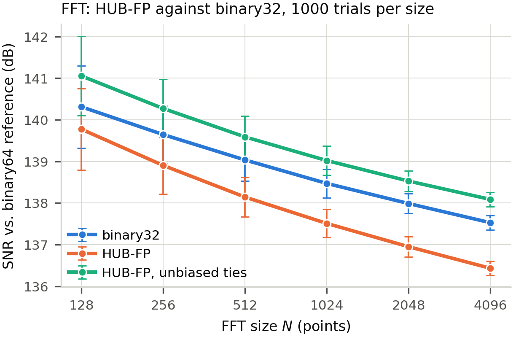

# FFT Implementation and Benchmarking

This directory contains an implementation of the Fast Fourier Transform (FFT) algorithm along with benchmarking tools to compare the precision of standard floating-point and HUB-format floating-point calculations.

## Overview

The FFT implementation in this directory provides a templated approach that works with different numeric types, including:
- Standard `float`
- Standard `double`
- Custom `hub_float` type

The code is designed to compare numerical accuracy between these types, with `double` precision used as the reference implementation.

## Files

- `fft.hpp`: Header file with templated function declarations for the FFT algorithm
- `fft.cpp`: Implementation of the FFT algorithm
- `main.cpp`: Benchmark program that compares precision between `float` and `hub_float` types

## FFT Algorithm

The implementation uses the Cooley-Tukey radix-2 decimation-in-time FFT algorithm, which:
1. Rearranges input data using bit-reversal permutation
2. Performs the butterfly operations for computation

The algorithm works in-place, meaning the input arrays are overwritten with the FFT results.

## Attribution

This FFT implementation is based on code from [Lloyd Rochester's Geek Blog](https://lloydrochester.com/post/c/example-fft/#c-implementation-of-the-fft). The Lloyd Rochester's Geek Blog is licensed under a [Creative Commons Attribution 4.0 International License](https://creativecommons.org/licenses/by/4.0/).

The code can also be found in the GitHub repository at https://github.com/lloydroc/arduino_fft, which is worth checking. The GitHub repository is available under the MIT license.

In accordance with these licenses, we acknowledge Lloyd Rochester as the original author and have adapted the code for our specific benchmarking needs.

## Benchmark

The benchmark program:
- Tests FFT on various sizes (powers of 2): 128, 256, 512, 1024, 2048, 4096
- Runs multiple trials (default: 1000) for statistical significance
- Compares `hub_float` against standard `float` using `double` as reference
- Analyzes both real and imaginary parts separately
- Calculates error statistics (average, maximum, minimum, relative errors, and SNR)

## Usage

### Running the Benchmark

Build from the repository root with `make`; the binary lands in `bin/`:

```bash
make
./bin/fft
```

The Makefile links `src/hub_float.cpp` and passes the flags the library relies on (`-std=c++17 -frounding-math -mno-fma`).
To try a different format, rebuild with, for example, `make clean && make EXP_BITS=5 MANT_BITS=10`.

### Output

The program produces:
1. Console output with summarized results
2. A CSV file containing detailed results for each trial
3. Optional Mathematica-compatible data files for deeper analysis

### CSV File Format

The generated CSV includes:
- FFT Size
- Type (`float` or `hub_float`)
- Component (real or imaginary)
- Trial number
- Average error
- Maximum error
- Minimum error
- Relative error
- Variance
- SNR (dB)

## Results

Console output, real part (the imaginary part tracks it to within 0.06 dB):

```
Size	Type		Part	Avg Error	Max Error	Min Error	Rel Error	SNR (dB)
128	float		real	0.0000003515	0.0000031173	0.0000000000	0.0000009478	140.3127553095
128	hub_float	real	0.0000003704	0.0000029078	0.0000000000	0.0000006301	139.7742292342
1024	float		real	0.0000012255	0.0000098504	0.0000000000	0.0000009800	138.4717068025
1024	hub_float	real	0.0000013569	0.0000109752	0.0000000000	0.0000009379	137.5100506402
4096	float		real	0.0000027417	0.0000244645	0.0000000000	0.0000010965	137.5282686543
4096	hub_float	real	0.0000030816	0.0000284427	0.0000000000	0.0000009860	136.4327047351
```

SNR against the `double` reference, at all six sizes (error bars are ±1 standard deviation over the 1000 trials):



The same values at three of the sizes:

| N | `float` | `hub_float` | `hub_float`, `-DUNBIASED_ROUNDING=1` |
|---:|---:|---:|---:|
| 128 | 140.31 dB | 139.77 dB | 141.05 dB |
| 1024 | 138.47 dB | 137.51 dB | 139.02 dB |
| 4096 | 137.53 dB | 136.43 dB | 138.09 dB |

`hub_float` stays within about 1.1 dB of `float` at every size, and with unbiased rounding it is about 0.6 dB ahead.
The deviation grows smoothly with transform size; there is no size at which `hub_float` behaves anomalously.
The last column is built with `make clean && make CXX="g++ -DUNBIASED_ROUNDING=1"`.
That option changes only the direction in which ties are rounded, never the size of an individual rounding error; across the transform it is worth 1.3–1.7 dB.

## Using the FFT Functions

```cpp
#include "fft.hpp"

// Example with float data
unsigned int N = 1024; // Must be a power of 2
std::vector<float> real_part(N), imag_part(N);

// Fill with your data...

// Perform FFT in-place
fft(real_part.data(), imag_part.data(), N);

// real_part and imag_part now contain the FFT result
```

## Notes

- The implementation requires the input length to be a power of 2
- Results are not normalized (divide by √N if normalization is needed)
- For the hub_float implementation, ensure the HUBsim library is properly linked